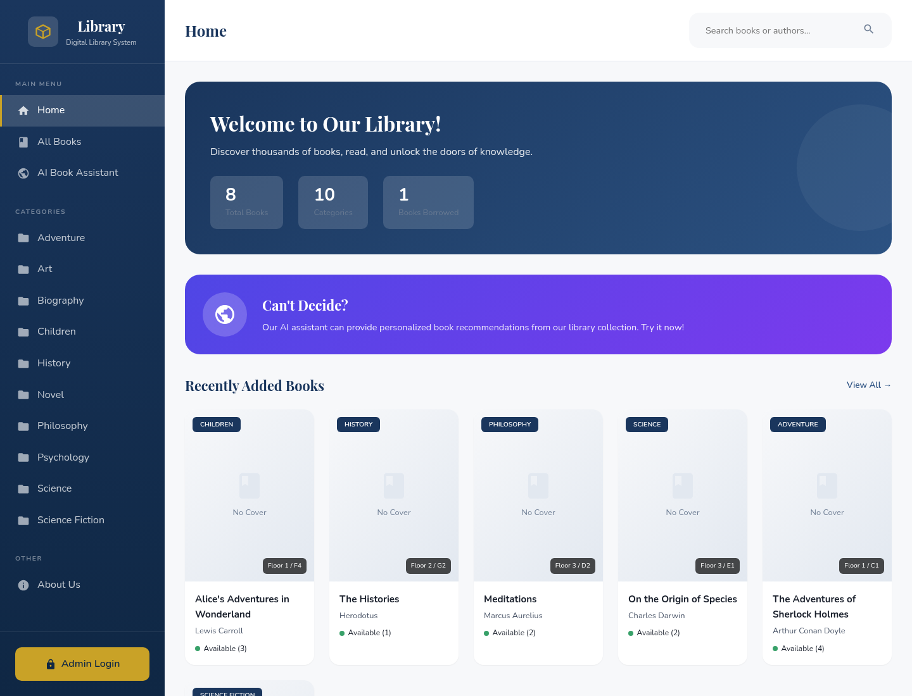
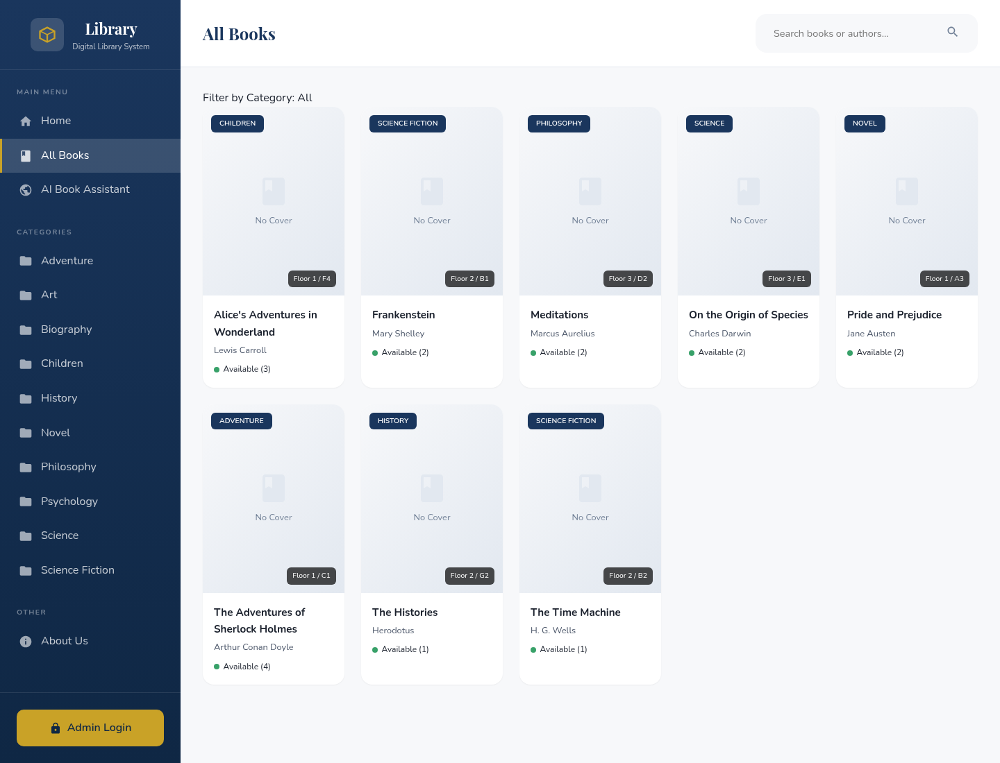
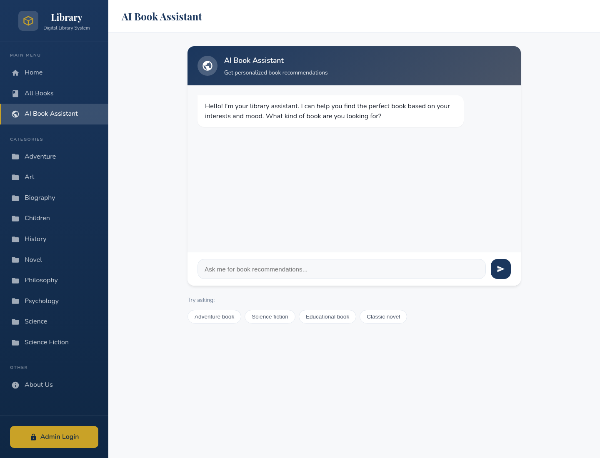
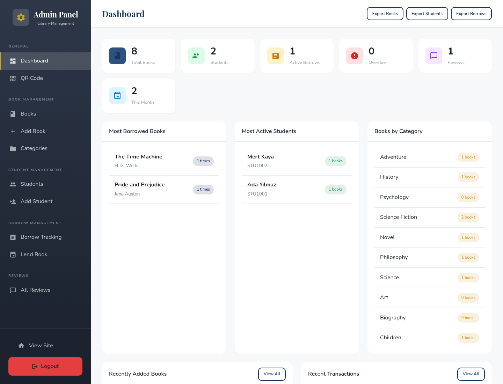

# Üniversite kütüphanesi için alternatif sistem

Okulumun kütüphanesi için alternatif bir sistem olarak geliştirdim. Öğrenciler katalogdaki kitapları arayıp raf konumunu görebilir. Yönetici tarafında öğrenci kaydı, ödünç-iade takibi ve yorum yönetimi var. Bir de mevcut katalogdan kitap öneren bir AI asistan bulunuyor.

## Özellikler

- Kitap kataloğu: arama, kategori filtresi, sayfalama
- Kitap detayı: yazar, ISBN, sayfa, basım yılı, stok, kat ve raf bilgisi
- Ödünç takibi: verme, iade, süreyi 7 gün uzatma, gecikme durumu
- Yorumlar: yalnızca o kitabı ödünç almış kayıtlı öğrenciler, kitap başına bir yorum, 1-5 yıldız ve isteğe bağlı metin
- Yönetim paneli: kitap, kategori ve öğrenci ekleme-düzenleme-silme, kapak görseli yükleme
- Kitap, öğrenci ve ödünç listelerini CSV olarak indirme
- Yerel ağdan erişim için QR kod
- AI kitap asistanı (aşağıda)

## AI ile kitap seçme

`/ai-assistant` sayfasında bir mesaj yazılıyor, istek `/api/ai-recommend` adresine gidiyor. Sunucu o andaki katalogdaki kitapları (başlık, yazar, kategori, stok, kat/raf, varsa ortalama puan) bir sistem metnine ekliyor ve Anthropic Claude API'sine gönderiyor. Kullanılan model `claude-sonnet-4-20250514`. Asistandan yalnızca listedeki kitapları önermesi, konum ve müsaitlik bilgisini de yazması isteniyor.

Bu kısım için `ANTHROPIC_API_KEY` gerekiyor. Anahtar yoksa sohbet yanıt vermez; uygulamanın geri kalanı yine açılır.

## Kullanılan teknolojiler

- Python, Flask, Flask-SQLAlchemy
- SQLite
- HTML, CSS, JavaScript (Jinja2)
- Anthropic Claude API (isteğe bağlı)
- qrcode ve Pillow (QR kod için)
- python-dotenv (`.env` okumak için)

## Kurulum

```bash
python3 -m venv venv
source venv/bin/activate
pip install -r requirements.txt
cp .env.example .env
```

`.env` dosyasındaki `SECRET_KEY` değerini değiştirin. AI asistanı kullanacaksanız `ANTHROPIC_API_KEY` ekleyin, kullanmayacaksanız boş bırakabilirsiniz.

Örnek bir katalog eklemek için (kurgu veriler, gerçek öğrenci kaydı yok):

```bash
python seed_data.py
python app.py
```

- Ana site: http://127.0.0.1:5000
- Yönetim paneli: http://127.0.0.1:5000/admin

Veritabanı ilk kez oluşurken varsayılan yönetici hesabı da eklenir. Kullanıcı adı `admin`, şifre `.env` içindeki `ADMIN_PASSWORD`, o da yoksa `admin123`. Bunu ilk girişten sonra değiştirin.

## Ekran görüntüleri

Ana sayfa:



Kitap listesi:



AI kitap asistanı:



Yönetim paneli:



`docs/screenshots` klasöründe kitap detayı ve ödünç listesinin görüntüleri de var.

## Notlar

- Arayüz İngilizce.
- Depodaki örnek veriler kurgu. Gerçek kütüphane veya öğrenci verisi yok.
- AI sohbeti anahtar olmadan çalışmaz.
- Uygulama şu anda geliştirme ayarlarıyla açılıyor (`debug=True`, `host=0.0.0.0`). Gerçek bir ortama koymadan önce bunları değiştirmek gerekir.
- Öğrenci tarafında ayrı bir giriş yok. Yorum bırakmak için öğrenci numarası yazılıyor.
- `.env` dosyasını repoya eklemeyin.

## English

This is an alternative library system I built for my university library. It has a public catalog with search, categories, shelf location and availability, plus an admin panel for students, borrowing, reviews and CSV export. There is also an optional AI assistant that recommends books only from the current catalog, using the Anthropic Claude API.

Setup: create a virtualenv, install `requirements.txt`, copy `.env.example` to `.env`, run `python seed_data.py`, then `python app.py`. The site is at http://127.0.0.1:5000, the admin panel at http://127.0.0.1:5000/admin. The AI chat needs `ANTHROPIC_API_KEY`; the rest of the app runs without it. The first admin account is `admin`, with the password from `ADMIN_PASSWORD` or `admin123` if that is not set.
